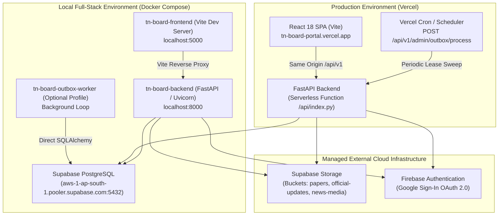

# Deployment Guide — Hungry Learner / TN Board Portal

This document outlines the deployment architecture, configuration guidelines, database migration protocol, and outbox worker scheduling for the Hungry Learner platform.

---

## 1. System Deployment Architecture

The platform uses a two-tier operational model:



---

## 2. Production Vercel Deployment

In production, frontend and backend are deployed together as a unified monorepo on Vercel:
- **Project URL**: `https://tn-board-portal.vercel.app`
- **Frontend**: Static React build output in `frontend/dist`.
- **Backend**: FastAPI app served via serverless Python entry point at `api/index.py`.
- **Routing**: `vercel.json` maps `/api/(.*)`, `/docs`, `/openapi.json`, and `/health` to `api/index.py`, and all other paths to `/index.html` for client-side React Router navigation.

### Production Environment Variables (Configured in Vercel Dashboard)

| Variable Name | Scope | Description |
|---|:---:|---|
| `SUPABASE_DATABASE_URL` | Backend | Direct PostgreSQL connection string to Supabase pooler (port 5432). |
| `SUPABASE_URL` | Backend | Project API URL (`https://<project-id>.supabase.co`). |
| `SUPABASE_ANON_KEY` | Backend | Supabase public anonymous API key. |
| `SUPABASE_SERVICE_ROLE_KEY` | Backend | Supabase service-role secret key (for server-side Storage cleanup). |
| `FIREBASE_SERVICE_ACCOUNT_JSON` | Backend | Complete JSON string content of the Firebase service account key. |
| `ADMIN_EMAIL` | Backend | Primary Super Admin email (`hungrylearner786@gmail.com`). |
| `CORS_ORIGINS` | Backend | Allowed origins (`https://tn-board-portal.vercel.app`). |
| `ENVIRONMENT` | Backend | Set to `production`. |
| `LOG_LEVEL` | Backend | Set to `INFO`. |
| `VITE_SUPABASE_URL` | Frontend | Embedded in client for public file downloads and real-time. |
| `VITE_SUPABASE_ANON_KEY` | Frontend | Embedded in client for public read queries. |
| `VITE_FIREBASE_API_KEY` | Frontend | Firebase client API key. |
| `VITE_FIREBASE_AUTH_DOMAIN` | Frontend | Firebase Auth domain (`tn-board-portal.firebaseapp.com`). |
| `VITE_FIREBASE_PROJECT_ID` | Frontend | Firebase project ID (`tn-board-portal`). |
| `VITE_FIREBASE_STORAGE_BUCKET` | Frontend | Firebase Storage bucket. |
| `VITE_FIREBASE_MESSAGING_SENDER_ID` | Frontend | Firebase messaging sender ID. |
| `VITE_FIREBASE_APP_ID` | Frontend | Firebase Web application ID. |

---

## 3. Database Migration Protocol

### Pending Production Migrations
The following migrations have been tested and verified locally against PostgreSQL 16 containers, but **must be explicitly applied to production Supabase** during an authorized maintenance window:

1. **Migration 031** (`supabase/migrations/031_claim_appointment_concurrency_fix.sql`):
   - Adds PostgreSQL advisory locks and transaction isolation to `claim_admin_appointment()`.
   - Guarantees single-claim atomicity, prevents double-claim races, and records previous role history.
2. **Migration 032** (`supabase/migrations/032_storage_outbox.sql`):
   - Creates the `storage_outbox` table, check constraints, partial indexes, and RLS policies.
   - Required for asynchronous, durable Supabase Storage deletions.

### Safe Application Steps:
1. Open the **Supabase Dashboard → SQL Editor**.
2. Run `031_claim_appointment_concurrency_fix.sql` and verify execution.
3. Run `032_storage_outbox.sql` and verify:
   ```sql
   SELECT table_name FROM information_schema.tables WHERE table_name = 'storage_outbox';
   SELECT indexname FROM pg_indexes WHERE tablename = 'storage_outbox';
   ```
4. **DO NOT** execute destructive rollback commands (`DROP TABLE ... CASCADE`) in production.

---

## 4. Transactional Storage Outbox Scheduling

Because Vercel serverless microVMs are ephemeral and do not run standing background daemons, outbox processing in production is triggered via scheduled HTTP invocation:

### Option A: External Webhook / Vercel Cron
Schedule an authenticated POST request every 1 to 5 minutes:
```http
POST /api/v1/admin/outbox/process?batch_size=25&lease_seconds=60
Authorization: Bearer <SUPER_ADMIN_BEARER_TOKEN>
```

### Option B: Local Docker Worker Service
In local development, the worker can run continuously in an isolated container using Docker Compose profiles:
```bash
docker compose --profile worker up -d
```
The worker polls the `storage_outbox` table using `SELECT FOR UPDATE SKIP LOCKED`, claims pending jobs, executes storage deletions with idempotency handling, and transitions failed jobs to `DEAD_LETTER` after 5 attempts.

---

## 5. Monitoring and Verification

### Health Endpoints:
- `GET https://tn-board-portal.vercel.app/health`
- `GET https://tn-board-portal.vercel.app/api/v1/health`

### Outbox Queue Inspection:
- `GET /api/v1/admin/outbox/status` (Admin only)
- Or directly via PostgreSQL:
  ```sql
  SELECT status, count(*) FROM storage_outbox GROUP BY status;
  SELECT * FROM storage_outbox WHERE status IN ('FAILED', 'DEAD_LETTER') ORDER BY updated_at DESC LIMIT 20;
  ```